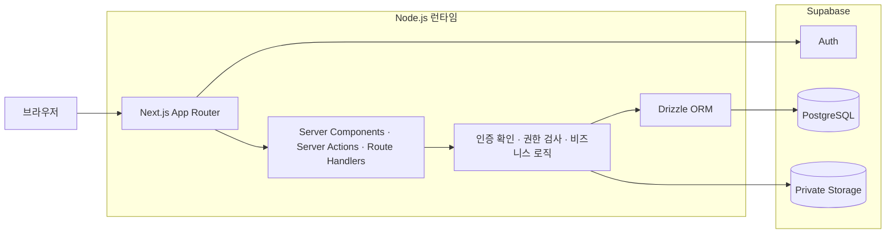
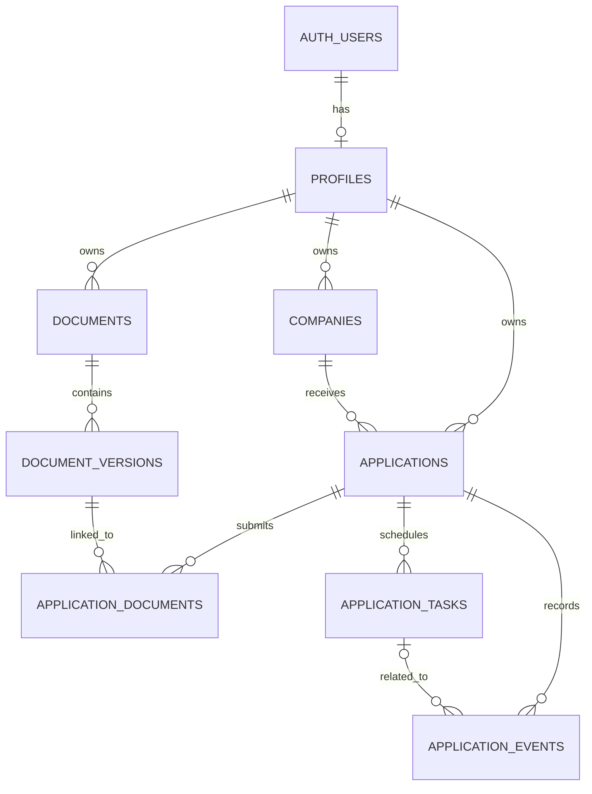

# MILO 아키텍처

## 상태

초안 — 확정된 선택부터 기록하며 미결정 항목은 구현 전에 순차적으로 보완한다.

## 시스템 개요

MVP는 Next.js App Router 기반의 단일 풀스택 애플리케이션으로 구성한다.
화면 렌더링, 사용자 요청 처리, 인증 확인과 비즈니스 로직을 Next.js에서 담당하고,
별도의 Express 또는 NestJS 백엔드 서버는 두지 않는다.



AI 분석, 이메일 처리, OCR처럼 요청 시간이 길거나 재시도가 필요한 작업이 생기면
별도 Node.js Worker와 작업 큐를 추가하는 방식을 검토한다. 이는 MVP 구성에 포함하지 않는다.

## 확정된 기술 선택

| 영역 | 선택 | 상태 |
| --- | --- | --- |
| 애플리케이션 | Next.js App Router 풀스택 | 확정 |
| 언어 | TypeScript strict | 확정 |
| 서버 런타임 | Node.js | 확정 |
| 데이터베이스 | Supabase PostgreSQL | 확정 |
| 인증 | Supabase Auth 기반 Google·Kakao OAuth | 확정 |
| 파일 저장 | Supabase Storage | 확정 |
| ORM 및 마이그레이션 | Drizzle ORM, Drizzle Kit | 확정 |
| 스타일링 | Tailwind CSS | 확정 |
| UI 컴포넌트 | shadcn/ui | 확정 |
| 별도 백엔드 서버 | MVP에서는 사용하지 않음 | 확정 |
| 서버·클라이언트 상태 관리, 차트 | 추후 결정 | 미결정 |
| 배포 환경 | 추후 결정 | 미결정 |

## 컴포넌트 책임

| Component | Responsibility | Notes |
| --- | --- | --- |
| Next.js App Router | 페이지, 레이아웃, 서버 렌더링과 요청 진입점 | 서버 컴포넌트를 기본으로 사용한다. |
| Server Actions | 화면에 종속된 데이터 변경 | 모든 작업에서 인증과 소유권을 확인한다. |
| Route Handlers | 파일 처리, 외부 연동, 공개 API가 필요한 HTTP 요청 | 필요한 경우에만 추가한다. |
| Domain/Application Logic | 지원 상태 변경, 일정, 통계 등 핵심 규칙 | UI와 DB 접근 코드에 규칙을 중복하지 않는다. |
| Drizzle ORM | PostgreSQL 스키마, 쿼리와 타입 안전성 | 서버 전용으로 사용한다. |
| Drizzle Kit | SQL 마이그레이션 생성 및 변경 이력 관리 | 생성된 마이그레이션을 Git에 포함한다. |
| Supabase Auth | Google·Kakao OAuth, 세션과 사용자 식별 | 이메일·비밀번호 로그인은 제공하지 않는다. |
| Supabase PostgreSQL | 지원, 문서 메타데이터, 일정과 이벤트 저장 | 원본 PDF는 저장하지 않는다. |
| Supabase Storage | 이력서와 자기소개서 PDF 비공개 저장 | 영구 공개 URL을 제공하지 않는다. |
| Tailwind CSS | 반응형 레이아웃과 디자인 토큰 기반 스타일링 | 임의 값 남용을 피하고 공통 토큰을 우선한다. |
| shadcn/ui | 접근 가능한 UI 컴포넌트 기반 제공 | 프로젝트가 소유하는 컴포넌트 코드를 목적에 맞게 조정한다. |

### UI 구성 원칙

- Tailwind CSS와 shadcn/ui를 기본 UI 구성으로 사용한다.
- 공통 색상, 간격, 모서리와 타이포그래피를 디자인 토큰으로 관리한다.
- shadcn/ui 컴포넌트를 그대로 복제해 쌓기보다 MILO의 공통 컴포넌트로 정리한다.
- 모바일과 데스크톱에서 동일한 핵심 흐름을 완료할 수 있어야 한다.
- 상태, 오류와 선택 여부를 색상만으로 전달하지 않는다.
- TanStack Query와 Zustand는 초기 필수 의존성으로 설치하지 않고 실제 상태 문제가 확인될 때 도입한다.

## 기본 데이터 흐름

### 소셜 로그인

1. 사용자가 Google 또는 Kakao 로그인을 선택한다.
2. Supabase Auth가 해당 제공자의 OAuth 인증 화면으로 이동시킨다.
3. 인증이 완료되면 Next.js 콜백에서 코드를 세션으로 교환한다.
4. 서버는 Supabase 사용자 ID를 기준으로 MILO 사용자 프로필을 조회하거나 생성한다.
5. 이후 모든 개인 데이터 요청에서 세션과 데이터 소유자를 확인한다.

로그인에는 식별에 필요한 최소 범위만 요청한다. Google 로그인과 Gmail 채용 메일 분석은
서로 다른 권한으로 취급하며 로그인 시 Gmail 읽기 권한을 요청하지 않는다.
Naver 로그인은 MVP 이후에 별도 기술 검증을 거쳐 추가한다.

### 데이터 조회 및 변경

1. 브라우저가 Next.js에 요청한다.
2. 서버가 Supabase Auth 세션을 확인한다.
3. 서버가 요청한 데이터의 사용자 소유권을 확인한다.
4. Drizzle을 통해 Supabase PostgreSQL을 조회하거나 변경한다.
5. 서버가 필요한 결과만 브라우저에 반환한다.

Drizzle과 데이터베이스 연결 문자열은 브라우저 번들에 포함하지 않는다.
브라우저에서 PostgreSQL에 직접 접속하지 않는다.

### PDF 업로드 및 조회

1. 서버가 로그인 세션과 파일 소유자를 확인한다.
2. 확장자뿐 아니라 실제 PDF 형식, 10MB 제한과 암호화 여부를 검사한다.
3. 원본 파일을 Supabase Storage의 비공개 버킷에 저장한다.
4. 저장 경로, 파일 크기, 문서 버전과 소유자 메타데이터를 PostgreSQL에 저장한다.
5. 조회 시 권한 확인 후 짧은 유효기간의 접근 주소를 발급한다.

파일 저장과 메타데이터 저장 중 한쪽이 실패할 경우 고아 파일이나 불완전한 버전이
남지 않도록 보상 처리 또는 정리 작업이 필요하다.

## 핵심 데이터 모델 초안

지원 기록을 중심으로 기업, 제출 문서 버전, 상태 이벤트와 일정을 연결한다.
채용공고는 MVP에서 독립 엔터티로 만들지 않고 지원 기록에 URL과 내용을 저장한다.
지원 전 관심 공고 기능을 구현할 때 별도 모델 도입을 검토한다.



| 테이블 | 책임 | 주요 데이터 |
| --- | --- | --- |
| `profiles` | MILO 사용자 프로필 | Supabase 사용자 ID, 표시 이름, 시간대 |
| `companies` | 사용자가 관리하는 지원 기업 | 사용자 ID, 기업명, 검색용 정규화 이름, 메모, 보관 시각 |
| `applications` | 개별 기업·직무 지원과 현재 상태 | 사용자·기업 ID, 직무, 지원일, 공고 URL, 현재 단계, 전체 결과, 종료 사유 |
| `documents` | 이력서·자기소개서의 독립된 문서 단위 | 사용자 ID, 문서 종류, 문서명, 보관 시각 |
| `document_versions` | 변경 불가능한 문서 버전과 파일 메타데이터 | 사용자·문서 ID, 버전 번호, 별칭, 변경 내용, 비공개 저장 경로, 파일 정보 |
| `application_documents` | 실제 제출 버전과 지원 기록의 다대다 연결 | 사용자·지원·문서 버전 ID, 연결 시각 |
| `application_events` | 지원 상태 변경과 되돌리기 이력 | 사용자·지원 ID, 이전·변경 상태, 이벤트 종류, 변경 주체, 관련 일정, 되돌린 이벤트 |
| `application_tasks` | 지원별 일정과 다음 할 일 | 사용자·지원 ID, 종류, 제목, 예정 날짜, 선택 시간, 시간대, 완료 시각, 메모 |

### 모델링 원칙

- 모든 기본 키는 UUID를 사용한다.
- 시각은 UTC 기준 `timestamptz`로 저장하고 화면에서 사용자 시간대로 표시한다.
- 지원 날짜처럼 시각이 필요 없는 값은 `date`로 저장한다.
- `profiles.id`는 Supabase Auth 사용자 ID를 참조하며 소셜 이메일을 별도 복제하지 않는다.
- 모든 사용자 데이터 테이블은 `user_id`를 직접 저장해 권한 필터 누락 위험을 낮춘다.
- 하위 테이블은 `(parent_id, user_id)` 복합 외래 키로 부모와 소유자가 일치하도록 강제한다.
- 문서 버전 번호는 같은 문서 안에서 중복될 수 없다.
- 같은 지원과 문서 버전의 연결은 한 번만 허용한다.
- 현재 지원 상태와 상태 변경 이벤트는 하나의 데이터베이스 트랜잭션에서 함께 기록한다.
- 상태 이벤트는 수정하거나 덮어쓰지 않으며 되돌리기는 원본 이벤트를 참조하는 새 이벤트로 추가한다.
- 일정 완료 여부와 전형 결과는 별도 데이터로 유지한다.
- 여러 면접은 `application_tasks`의 개별 일정으로 구분하고 관련 상태 이벤트를 연결할 수 있다.
- 통계는 지원 기록과 이벤트에서 계산하며 MVP에서는 계산 결과를 별도 원본 테이블에 저장하지 않는다.

### 일정 날짜와 시간

- `scheduled_on`은 필수 `date`로 저장한다.
- `scheduled_time`은 선택 `time`으로 저장한다.
- `time_zone`은 IANA 시간대 문자열로 저장하고 생성 시 사용자 프로필 시간대를 기본값으로 사용한다.
- 사용자가 프로필 시간대를 변경해도 기존 일정의 시간대는 자동 변경하지 않는다.
- 시간이 있는 일정은 해당 지역의 정확한 시각이 지난 후 기한 초과로 처리한다.
- 날짜만 있는 일정은 해당 지역에서 그날이 끝난 후 기한 초과로 처리한다.
- 같은 날짜에서는 시간이 있는 일정을 시간순으로 먼저 표시하고 날짜만 있는 일정은 그 뒤에 표시한다.
- 일정 완료 시 `completed_at`을 기록하며 완료 여부가 전형 결과를 자동으로 변경하지 않는다.

### 기업 중복과 삭제

- 기업은 사용자별 데이터이며 서로 다른 사용자의 기업 레코드를 자동 공유하지 않는다.
- 기업명 앞뒤 공백 제거와 대소문자 정규화 결과를 검색 보조값으로 저장한다.
- 같은 사용자가 유사한 기업명을 입력하면 기존 기업을 먼저 제안한다.
- 동명의 다른 법인이 있을 수 있으므로 데이터베이스에서 이름 중복을 강제로 막지 않는다.
- 지원 기록이 연결된 기업은 기본적으로 보관 처리하고, 영구 삭제 시 영향 범위를 별도 확인한다.

### 상태 이벤트 구조

`application_events`에는 다음 정보를 명시적인 컬럼으로 저장한다.

- 이벤트 종류: 지원 완료, 단계 진입, 단계 합격, 단계 불합격, 지원 종료, 지원 재개, 되돌리기
- 변경 전·후 현재 단계
- 변경 전·후 전체 결과
- 변경 전·후 종료 사유
- 변경 주체: 사용자, 이메일 자동화, 시스템
- 발생 시각과 선택적인 관련 일정 ID
- 되돌리기 대상 이벤트 ID

이벤트 전체를 불투명한 JSON 하나로 저장하지 않는다. 외부 자동화의 추가 정보처럼
형태가 가변적인 보조 데이터만 제한된 `metadata` JSONB에 저장하며 민감한 메일 본문은 넣지 않는다.

### 데이터베이스 제약조건과 인덱스

- 단계, 결과, 종료 사유, 이벤트 종류, 변경 주체, 문서 종류와 일정 종류는 PostgreSQL enum으로 제한한다.
- 전체 결과가 `종료`일 때만 종료 사유를 필수로 요구하는 check constraint를 둔다.
- 복합 외래 키의 부모 테이블에는 `(id, user_id)` unique constraint를 함께 둔다.
- `(document_id, version_number)`와 `(application_id, document_version_id)`에 unique constraint를 둔다.
- 사용자별 지원 목록과 필터를 위해 `(user_id, updated_at)`, `(user_id, current_stage, overall_result)`를 인덱싱한다.
- 다음 할 일 조회를 위해 `(user_id, completed_at, scheduled_on, scheduled_time)`를 인덱싱한다.
- 타임라인 조회를 위해 `(application_id, occurred_at)`를 인덱싱한다.
- 외래 키 컬럼은 조회 및 삭제 성능을 고려해 필요한 인덱스를 명시적으로 생성한다.

### 문서 삭제 표현

- 원본 파일만 삭제하면 `document_versions` 메타데이터는 유지하고 저장 경로를 제거한다.
- 원본 파일 삭제 시 `file_deleted_at`을 기록한다.
- 원본 삭제 시 파일에서 파생된 미리보기, 추출 텍스트와 AI 결과도 함께 삭제한다.
- 문서 버전 전체를 삭제하면 `application_documents` 연결을 제거하되 지원 기록은 유지한다.
- 문서 보관은 `documents.archived_at`으로 표현하고 영구 삭제와 구분한다.

### 추가로 확정할 항목

- 지원 기록 보관 기능을 별도로 제공할지 여부
- 기업 영구 삭제 시 연결된 지원 기록 처리 방식

## 저장소 구조

```text
milo/
├── AGENTS.md
├── docs/
├── src/
├── package.json
└── README.md
```

구체적인 `src` 하위 구조는 도메인 모델과 UI 구성을 확정한 뒤 추가한다.

## 외부 의존성

- Supabase PostgreSQL
- Supabase Auth
- Supabase Storage

서비스 제공자 장애와 무료 요금제 제한에 영향을 받을 수 있으므로 사용량, 백업과
이전 가능성을 운영 단계에서 검토한다.

## 보안 및 개인정보

- Drizzle은 Next.js 서버에서만 사용한다.
- 데이터베이스 연결 문자열과 Supabase 비밀 키는 서버 환경변수로만 관리한다.
- 모든 개인 데이터 조회와 변경에 인증 및 `userId` 소유권 검사를 적용한다.
- 다른 사용자 데이터 접근을 차단하는 권한 테스트를 작성한다.
- Storage는 비공개 버킷과 최소 권한 정책을 사용한다.
- OAuth `client_secret`과 제공자 토큰을 브라우저나 로그에 노출하지 않는다.
- 이름이나 닉네임만으로 서로 다른 소셜 계정을 자동 병합하지 않는다.
- 원본 PDF 내용과 영구 접근 주소를 로그에 기록하지 않는다.

### 접근 권한 모델

- 권한의 기본값은 거부다. 권한 레코드가 없으면 소유자 외에는 접근할 수 없다.
- MVP에서는 공유 기능을 제공하지 않으므로 모든 사용자 데이터는 소유자만 접근한다.
- PostgreSQL 사용자 데이터 테이블과 Storage 객체에 소유자 전용 RLS 정책을 적용한다.
- Next.js 서버는 모든 Drizzle 조회와 변경에 인증된 `user_id` 조건을 명시한다.
- 브라우저가 전달한 `user_id`를 신뢰하지 않고 서버 세션에서 소유자를 결정한다.
- 권한 확인 로직은 도메인별 저장소 또는 권한 함수에 모아 화면과 API에서 중복 구현하지 않는다.

MVP 이후 공유 기능을 추가할 때는 소유자가 특정 자원과 허용 동작을 명시적으로 선택한
활성 권한만 인정한다. 권한에는 소유자, 대상 사용자 또는 공개 범위, 자원, 허용 동작,
생성 시각, 만료 시각과 철회 시각을 기록한다.

- 문서 버전 공유는 해당 PDF 조회만 허용하며 기업 지원 기록, 결과, 통계와 메모를 함께 공개하지 않는다.
- 댓글 또는 첨삭 권한은 단순 조회 권한과 분리한다.
- 공유를 철회하면 새로운 조회와 임시 링크 발급을 즉시 차단한다.
- PDF 접근 주소는 권한 확인 후 짧은 유효기간으로 발급한다.
- 이미 사용자가 내려받은 파일은 기술적으로 회수할 수 없음을 공유 전에 안내한다.
- 중요한 공유, 접근과 철회는 감사 가능한 기록으로 남긴다.

Drizzle의 직접 데이터베이스 연결은 사용하는 DB 역할에 따라 RLS를 우회할 수 있다.
따라서 RLS를 자동 보호 계층으로 가정하지 않고 서버 권한 검사와 테스트를 필수로 둔다.

## 배포 및 운영

- GitHub Actions에서 타입 검사, 린트, 테스트와 프로덕션 빌드를 검증한다.
- 배포 제공자와 개발·스테이징·운영 환경 분리 방식은 추후 결정한다.
- 데이터베이스 마이그레이션의 운영 적용 방식은 배포 전략과 함께 결정한다.
- AI, 이메일, OCR 작업은 필요성이 확인되기 전까지 별도 서비스를 만들지 않는다.

## 알려진 위험과 미결정 사항

- Supabase 무료 플랜의 데이터베이스, 파일 저장 및 전송량 제한
- 무료 프로젝트의 비활성 일시 중지와 자동 백업 부재
- Drizzle 직접 연결의 권한 필터 누락 위험
- PDF 저장과 메타데이터 기록 사이의 부분 실패
- 사용자별 전체 파일 저장 용량
- 소셜 제공자 간 계정 연결 및 중복 계정 처리 정책
- Naver Custom OAuth 호환성 및 도입 시점
- 배포 제공자, 리전, 백업과 복구 정책
- 장시간 비동기 작업을 분리할 시점과 작업 큐 선택
