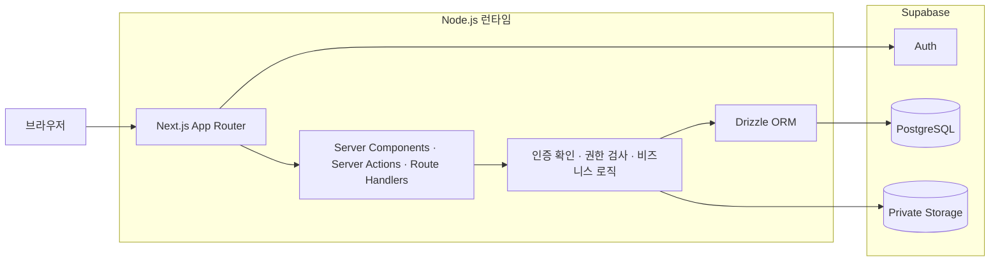

# MILO 아키텍처

## 상태

초안 — 확정된 선택부터 기록하며 미결정 항목은 구현 전에 순차적으로 보완한다.

## 시스템 개요

MVP는 Next.js App Router 기반의 단일 풀스택 애플리케이션으로 구성한다.
화면 렌더링, 사용자 요청 처리, 인증 확인과 비즈니스 로직을 Next.js에서 담당하고,
별도의 Express 또는 NestJS 백엔드 서버는 두지 않는다.



AI 분석, 이메일 처리, OCR처럼 요청 시간이 길거나 재시도가 필요한 작업이 생기면
별도 Node.js Worker와 작업 큐를 추가하는 방식을 검토한다. 이는 MVP 구성에 포함하지 않는다.

## 확정된 기술 선택

| 영역 | 선택 | 상태 |
| --- | --- | --- |
| 애플리케이션 | Next.js App Router 풀스택 | 확정 |
| 언어 | TypeScript strict | 확정 |
| 서버 런타임 | Node.js | 확정 |
| 데이터베이스 | Supabase PostgreSQL | 확정 |
| 인증 | Supabase Auth 기반 Google·Kakao OAuth | 확정 |
| 파일 저장 | Supabase Storage | 확정 |
| ORM 및 마이그레이션 | Drizzle ORM, Drizzle Kit | 확정 |
| 별도 백엔드 서버 | MVP에서는 사용하지 않음 | 확정 |
| UI, 상태 관리, 차트 | 추후 결정 | 미결정 |
| 배포 환경 | 추후 결정 | 미결정 |

## 컴포넌트 책임

| Component | Responsibility | Notes |
| --- | --- | --- |
| Next.js App Router | 페이지, 레이아웃, 서버 렌더링과 요청 진입점 | 서버 컴포넌트를 기본으로 사용한다. |
| Server Actions | 화면에 종속된 데이터 변경 | 모든 작업에서 인증과 소유권을 확인한다. |
| Route Handlers | 파일 처리, 외부 연동, 공개 API가 필요한 HTTP 요청 | 필요한 경우에만 추가한다. |
| Domain/Application Logic | 지원 상태 변경, 일정, 통계 등 핵심 규칙 | UI와 DB 접근 코드에 규칙을 중복하지 않는다. |
| Drizzle ORM | PostgreSQL 스키마, 쿼리와 타입 안전성 | 서버 전용으로 사용한다. |
| Drizzle Kit | SQL 마이그레이션 생성 및 변경 이력 관리 | 생성된 마이그레이션을 Git에 포함한다. |
| Supabase Auth | Google·Kakao OAuth, 세션과 사용자 식별 | 이메일·비밀번호 로그인은 제공하지 않는다. |
| Supabase PostgreSQL | 지원, 문서 메타데이터, 일정과 이벤트 저장 | 원본 PDF는 저장하지 않는다. |
| Supabase Storage | 이력서와 자기소개서 PDF 비공개 저장 | 영구 공개 URL을 제공하지 않는다. |

## 기본 데이터 흐름

### 소셜 로그인

1. 사용자가 Google 또는 Kakao 로그인을 선택한다.
2. Supabase Auth가 해당 제공자의 OAuth 인증 화면으로 이동시킨다.
3. 인증이 완료되면 Next.js 콜백에서 코드를 세션으로 교환한다.
4. 서버는 Supabase 사용자 ID를 기준으로 MILO 사용자 프로필을 조회하거나 생성한다.
5. 이후 모든 개인 데이터 요청에서 세션과 데이터 소유자를 확인한다.

로그인에는 식별에 필요한 최소 범위만 요청한다. Google 로그인과 Gmail 채용 메일 분석은
서로 다른 권한으로 취급하며 로그인 시 Gmail 읽기 권한을 요청하지 않는다.
Naver 로그인은 MVP 이후에 별도 기술 검증을 거쳐 추가한다.

### 데이터 조회 및 변경

1. 브라우저가 Next.js에 요청한다.
2. 서버가 Supabase Auth 세션을 확인한다.
3. 서버가 요청한 데이터의 사용자 소유권을 확인한다.
4. Drizzle을 통해 Supabase PostgreSQL을 조회하거나 변경한다.
5. 서버가 필요한 결과만 브라우저에 반환한다.

Drizzle과 데이터베이스 연결 문자열은 브라우저 번들에 포함하지 않는다.
브라우저에서 PostgreSQL에 직접 접속하지 않는다.

### PDF 업로드 및 조회

1. 서버가 로그인 세션과 파일 소유자를 확인한다.
2. 확장자뿐 아니라 실제 PDF 형식, 10MB 제한과 암호화 여부를 검사한다.
3. 원본 파일을 Supabase Storage의 비공개 버킷에 저장한다.
4. 저장 경로, 파일 크기, 문서 버전과 소유자 메타데이터를 PostgreSQL에 저장한다.
5. 조회 시 권한 확인 후 짧은 유효기간의 접근 주소를 발급한다.

파일 저장과 메타데이터 저장 중 한쪽이 실패할 경우 고아 파일이나 불완전한 버전이
남지 않도록 보상 처리 또는 정리 작업이 필요하다.

## 저장소 구조

```text
milo/
├── AGENTS.md
├── docs/
├── src/
├── package.json
└── README.md
```

구체적인 `src` 하위 구조는 도메인 모델과 UI 구성을 확정한 뒤 추가한다.

## 외부 의존성

- Supabase PostgreSQL
- Supabase Auth
- Supabase Storage

서비스 제공자 장애와 무료 요금제 제한에 영향을 받을 수 있으므로 사용량, 백업과
이전 가능성을 운영 단계에서 검토한다.

## 보안 및 개인정보

- Drizzle은 Next.js 서버에서만 사용한다.
- 데이터베이스 연결 문자열과 Supabase 비밀 키는 서버 환경변수로만 관리한다.
- 모든 개인 데이터 조회와 변경에 인증 및 `userId` 소유권 검사를 적용한다.
- 다른 사용자 데이터 접근을 차단하는 권한 테스트를 작성한다.
- Storage는 비공개 버킷과 최소 권한 정책을 사용한다.
- OAuth `client_secret`과 제공자 토큰을 브라우저나 로그에 노출하지 않는다.
- 이름이나 닉네임만으로 서로 다른 소셜 계정을 자동 병합하지 않는다.
- 원본 PDF 내용과 영구 접근 주소를 로그에 기록하지 않는다.
- PostgreSQL RLS의 적용 범위와 Drizzle 연결 역할은 인증 설계 단계에서 확정한다.

Drizzle의 직접 데이터베이스 연결은 사용하는 DB 역할에 따라 RLS를 우회할 수 있다.
따라서 RLS를 자동 보호 계층으로 가정하지 않고 서버 권한 검사와 테스트를 필수로 둔다.

## 배포 및 운영

- GitHub Actions에서 타입 검사, 린트, 테스트와 프로덕션 빌드를 검증한다.
- 배포 제공자와 개발·스테이징·운영 환경 분리 방식은 추후 결정한다.
- 데이터베이스 마이그레이션의 운영 적용 방식은 배포 전략과 함께 결정한다.
- AI, 이메일, OCR 작업은 필요성이 확인되기 전까지 별도 서비스를 만들지 않는다.

## 알려진 위험과 미결정 사항

- Supabase 무료 플랜의 데이터베이스, 파일 저장 및 전송량 제한
- 무료 프로젝트의 비활성 일시 중지와 자동 백업 부재
- Drizzle 직접 연결과 Supabase RLS 정책의 책임 경계
- PDF 저장과 메타데이터 기록 사이의 부분 실패
- 사용자별 전체 파일 저장 용량
- 소셜 제공자 간 계정 연결 및 중복 계정 처리 정책
- Naver Custom OAuth 호환성 및 도입 시점
- 배포 제공자, 리전, 백업과 복구 정책
- 장시간 비동기 작업을 분리할 시점과 작업 큐 선택
