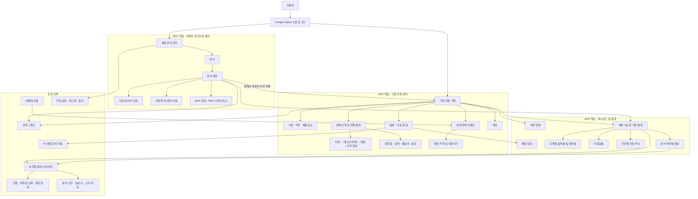

# MILO 기능 관계도

## 문서 목적

MILO의 주요 기능과 데이터 연결 관계를 한눈에 확인하기 위한 문서다.
세부 요구사항과 우선순위는 [`PRD.md`](PRD.md)를 기준으로 하며,
기술 구성과 데이터 흐름은 [`ARCHITECTURE.md`](ARCHITECTURE.md)에서 별도로 정의한다.

## 범례

- **MVP 핵심**: 첫 출시에서 구현할 기능
- **MVP 권장**: 핵심 흐름을 해치지 않는 범위에서 구현할 기능
- **후속 단계**: MVP 검증 이후 구현할 기능

## 기능 관계

## 구조 해석

기업 지원 기록이 서비스의 중심이다. 사용자는 문서 없이도 지원 기록을 먼저 만들 수 있고,
이력서나 자기소개서가 있다면 실제로 제출한 특정 버전을 나중에 연결할 수 있다.

대시보드의 기본 통계는 AI 없이 동일한 규칙으로 다시 계산할 수 있어야 한다.
AI는 MVP 이후 이 통계와 문서 버전별 결과를 해석하되, 분석 기간과 표본 수를 근거로
제시하고 결과의 인과관계를 단정하지 않는다.

